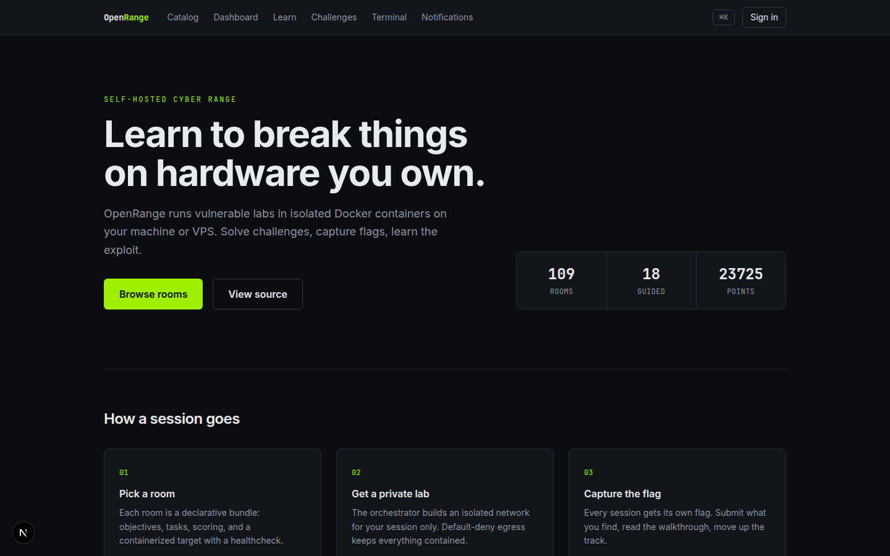

# OpenRange

Self-hosted cyber range for learning offensive and defensive security in isolated labs you run yourself.



OpenRange (repository name `home-ctf-box`) is a monorepo: a FastAPI control plane, a Next.js learner app, a lab gateway and runner for per-user containers, a content SDK, and a curriculum of original rooms, paths, and modules. It runs on one Linux machine. A Raspberry Pi 5 can host the control plane and lighter rooms; images are multi-arch.

Status snapshot (2026-08-24): 109 lab-backed room bundles across six tracks, four external OSS wrappers, 18 learning paths, and 54 modules. The platform includes a learning engine with streaks and localization, a jeopardy board, teams and events, scoring and leaderboards, organizations, notifications, a studio review workflow, observability, packaging, and CI security gates. Phase notes live in [`docs/roadmap/implementation-status.md`](docs/roadmap/implementation-status.md).

## Features

What works in this tree, each one traceable to the linked code:

- Accounts and access: local accounts, session cookies, CSRF, TOTP, recovery codes, WebAuthn, optional OIDC, and rate limits (`apps/api/src/openrange/api/auth/`).
- Personal labs: start, readiness, extend, reset, stop, expiry, and cross-tenant isolation at the API layer (`apps/api/src/openrange/api/labs/`).
- Learning engine: enrollment, section progress, and catalog queries (`apps/api/src/openrange/api/learning/`).
- Streaks: timezone-safe daily streaks with freeze days and milestone thresholds (`apps/api/src/openrange/api/streaks/`).
- Localization: bundle-level i18n with protected spans and a Hungarian sample (`packages/content-sdk/src/openrange/content/i18n.py`, `docs/i18n.md`).
- Jeopardy board: containerless challenges, attachments, dynamic score decay, and a submissions audit (`apps/api/src/openrange/api/challenges/`).
- Scoring: flag submission, first blood, and scoped leaderboards (`apps/api/src/openrange/api/scoring/`).
- Teams and events: rosters, invites, an event builder, and frozen scoreboards (`apps/api/src/openrange/api/teams/`, `apps/api/src/openrange/api/events/`).
- External labs: OWASP Juice Shop, DVWA, WebGoat, and WrongSecrets from upstream images pinned by digest (`docs/labs-external.md`).
- Remote access: WireGuard device lifecycle (`apps/api/src/openrange/api/vpn/routes.py`) and a browser VNC bridge (`apps/lab-gateway/src/openrange/gateway/desktop.py`).
- Web app: learning view, embedded terminal, jeopardy board, and a notifications inbox (`apps/web/app/learn`, `terminal`, `challenges`, `notifications`).
- Organizations, notifications, and a content-studio review workflow (`apps/api/src/openrange/api/orgs/`, `notifications/`, `studio/`).

## Tech stack

| Layer    | Choices                                                           |
| -------- | ----------------------------------------------------------------- |
| Web      | Next.js 15, React 19, TypeScript, Tailwind CSS 4                  |
| API      | FastAPI, SQLAlchemy, Alembic, PostgreSQL 16, Redis 7              |
| Labs     | Docker, HMAC-authenticated runner, browser SSH (xterm.js) and VNC |
| Content  | YAML bundles, `cyberrange` CLI, automated intended-path solvers   |
| Tooling  | pnpm, Turborepo, uv, Ruff, mypy, pytest, Playwright               |
| Shipping | Multi-stage images, Compose profiles, tag-triggered GHCR release  |

## What runs where

| Piece             | Path                   | What it is                                                                                          |
| ----------------- | ---------------------- | --------------------------------------------------------------------------------------------------- |
| Control plane API | `apps/api`             | Auth, labs, learning, streaks, challenges, scoring, teams, events, orgs, notifications, studio, VPN |
| Learner web app   | `apps/web`             | Catalog, dashboard, labs, learn, challenges, terminal, notifications, profile                       |
| Lab gateway       | `apps/lab-gateway`     | Authenticated HTTP proxy plus browser SSH and VNC                                                   |
| Lab runner        | `apps/lab-runner`      | Per-user container lifecycle with HMAC auth and a reconcile loop                                    |
| Content SDK       | `packages/content-sdk` | Room, path, and module schema, linting, solver harness, i18n, `cyberrange` CLI                      |
| Design system     | `packages/ui`          | Shared tokens and React components                                                                  |
| Content           | `content/`             | 109 room bundles, 18 paths, 54 modules                                                              |
| Compose stacks    | `infra/compose/`       | core, dev, runner, gateway, observability, and production profiles                                  |

## Quick start

```sh
make bootstrap   # uv + pnpm toolchains
make check       # ruff, mypy, prettier
make test        # fast unit suite
make up          # postgres :15432, redis :16379, minio :19000, meili :17700
```

Learner web app during development:

```sh
pnpm --filter web dev   # next dev on :3100
```

Content work:

```sh
make test-content   # cyberrange lint over every bundle
make test-solvers   # build room images and run intended-path solvers locally
```

Browser checks (Playwright starts the web app on port 3210):

```sh
make test-e2e    # journeys, including accessibility
make test-a11y   # axe and keyboard specs only
```

Operations:

```sh
make backup
make restore
docker compose -f infra/compose/observability.yml up -d   # prometheus :19090, grafana :13000
```

Production install steps are in [`docs/deployment.md`](docs/deployment.md). Copy `.env.example` to `.env` and uncomment the production block before using `infra/compose/production.yml`. Dev commands use safe local defaults and do not need that block.

These Make targets still exit with an error on purpose: `test-contract`, `test-security`, and `test-load`. Security scans run in [`.github/workflows/security.yml`](.github/workflows/security.yml). The gaps are tracked in [`docs/roadmap/implementation-status.md`](docs/roadmap/implementation-status.md).

## Legacy LAN demo

The original 20-room scoreboard still runs under the `legacy-v0` compose profile. Published ports bind to `127.0.0.1` unless you change `CTF_BIND`. Do not expose this profile to the internet.

```sh
docker compose --profile legacy-v0 up -d --build
```

Platform: http://localhost:8000 (override with `PLATFORM_PORT`). Rooms listen on ports 8081–8100, one service per room, 2975 points total.

| #   | Room                | Port | Points | Technique                            |
| --- | ------------------- | ---- | ------ | ------------------------------------ |
| 1   | Busted Login        | 8081 | 100    | SQL injection login bypass           |
| 2   | Nosy Files          | 8082 | 150    | Path traversal                       |
| 3   | Ping of Doom        | 8083 | 200    | Shell command injection              |
| 4   | SSTI Greeting       | 8084 | 150    | Jinja server-side template injection |
| 5   | Token Forger        | 8085 | 250    | JWT alg:none forgery                 |
| 6   | IDOR Invoices       | 8086 | 125    | Missing ownership check              |
| 7   | Open Panels         | 8087 | 50     | Exposed debug panel                  |
| 8   | Cookie Shapeshifter | 8088 | 100    | Unsigned base64 cookie forgery       |
| 9   | Regex Doom          | 8089 | 125    | Regex injection                      |
| 10  | Mass Assign         | 8090 | 150    | Blind mass assignment                |
| 11  | XXE Importer        | 8091 | 225    | External entity injection            |
| 12  | Pickle Jar          | 8092 | 275    | Unsafe deserialization RCE           |
| 13  | Trusted Proxy       | 8093 | 75     | X-Forwarded-For spoofing             |
| 14  | Wrong Method        | 8094 | 75     | HTTP verb tampering                  |
| 15  | Open Closet         | 8095 | 50     | Directory listing exposure           |
| 16  | Predictable Reset   | 8096 | 175    | Time-derived reset tokens            |
| 17  | Double Trouble      | 8097 | 150    | HTTP parameter pollution             |
| 18  | Fetch Boy           | 8098 | 200    | SSRF                                 |
| 19  | Union Vault         | 8099 | 225    | UNION-based SQL injection            |
| 20  | Brace Yourself      | 8100 | 125    | Python format string injection       |

Automated full solve from another machine:

```sh
PLATFORM_PORT=8000 ./scripts/demo-solve.sh
```

The script registers a throwaway player, exploits all twenty rooms, submits the flags, and exits non-zero unless the scoreboard confirms 2975 points.

```sh
make reset-demo   # destroy volumes and rebuild the demo, then run the solver
```

On a home LAN, bind the demo to every interface only if you trust that network:

```sh
CTF_BIND=0.0.0.0 docker compose --profile legacy-v0 up -d --build
```

Then browse to `http://<lan-address>:8000`.

## Safety

- Every published port binds to `127.0.0.1` by default (`CTF_BIND`).
- These services are vulnerable on purpose. Do not expose them to the internet, port-forward them, or run them on a shared host.
- Lab isolation uses default-deny networks created by the runner. See [`security/threat-model.md`](security/threat-model.md).
- Report control-plane vulnerabilities privately. See [`SECURITY.md`](SECURITY.md).

## Adding content

Rooms are declarative bundles under `content/rooms/<slug>/`: a `room.yaml` manifest, a target Dockerfile, lesson markdown, and a solver. Start from an existing bundle, then:

```sh
uv run cyberrange lint     # schema and writing-standard checks
make test-solvers          # prove the intended path solves cleanly
```

CI refuses content changes that fail either gate. Paths and modules follow the same pattern. See [`docs/content/catalog-status.md`](docs/content/catalog-status.md).

## Licence

Code is [AGPL-3.0-or-later](LICENSE). Training prose and assets under `content/` are CC BY-SA 4.0 unless a bundle's license field says otherwise. See [`NOTICE`](NOTICE), [`docs/content-licensing.md`](docs/content-licensing.md), and [`licenses/CC-BY-SA-4.0.txt`](licenses/CC-BY-SA-4.0.txt).
